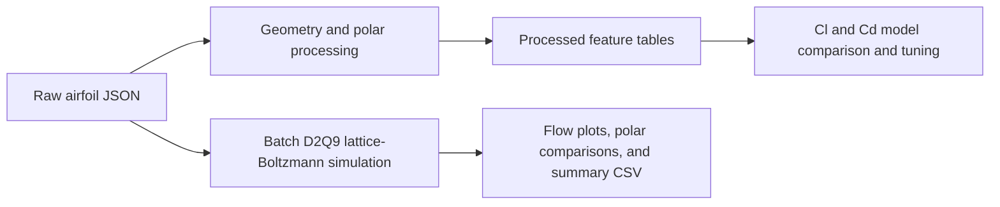

# AeroFoil

AeroFoil is a collection of airfoil data-processing, aerodynamic modeling, and
flow-visualization notebooks. It works with XFOIL-style airfoil JSON files,
extracts geometry and polar data, trains models to predict lift and drag
coefficients, and includes a batch lattice-Boltzmann flow simulation.

## Project workflow



## Repository layout

```text
.
|-- data/
|   |-- raw/json/                         # Source airfoil JSON files
|   |-- processed/processed_featurs/      # Metadata, aerodynamic, and ML CSVs
|   `-- processed/processed_geometry/     # Geometry, polar, and Cp outputs
|-- data processing/
|   |-- data_processing.ipynb             # Feature extraction and dataset analysis
|   `-- batch_process_airfoils.ipynb       # Parallel JSON-to-geometry/polar processing
|-- models/                                # Trained estimators and Random Forest chunks
|-- reports/                               # Project report documents
|-- tools/chunk_large_model.py             # Split/reassemble oversized model files
|-- Cd_Cl_model_annotated.ipynb            # Cl/Cd model training and tuning
`-- airfoil_navier_stokes_batch.ipynb       # Batch D2Q9 lattice-Boltzmann simulations
```

The repository includes 825 raw JSON airfoil files. Large datasets and model
artifacts are stored with Git LFS. Pulling LFS objects downloads several
gigabytes, so check your disk space and GitHub LFS quota first:

```bash
git lfs install
git lfs pull
```

## Notebooks

### Data processing

`data processing/data_processing.ipynb` audits the raw JSON collection, extracts
airfoil geometry features, assembles aerodynamic polar observations, combines
the data into a modeling table, and performs exploratory analysis.

`data processing/batch_process_airfoils.ipynb` processes airfoil JSON files in
parallel. It writes geometry features, resampled coordinates, a combined polar
table, optional pressure-coefficient arrays, and a failed-file log.

The main processed tables in `data/processed/processed_featurs/` are:

- `airfoil_metadata.csv`
- `airfoil_aerodynamic_data.csv`
- `airfoil_ml_dataset.csv`

The spelling `processed_featurs` is the directory name used in this repository.

### Lift and drag modeling

`Cd_Cl_model_annotated.ipynb` compares and tunes Random Forest,
HistGradientBoosting, LightGBM, and XGBoost regressors for lift coefficient
(`Cl`) and drag coefficient (`Cd`). Its inputs are geometry descriptors,
log-transformed Reynolds number, angle of attack, and `Ncrit`. The notebook
uses a group-based train/test split by airfoil and reports MAE, RMSE, and R-squared.

The processed ML table is now at
`data/processed/processed_featurs/airfoil_ml_dataset.csv`. The modeling notebook
currently reads `airfoil_ml_dataset.csv` from the repository root; before running
it, change that `pd.read_csv(...)` path to the processed-table path above, or
copy the CSV to the root.

### Flow simulation

`airfoil_navier_stokes_batch.ipynb` runs a D2Q9 lattice-Boltzmann simulation on
airfoil geometries. It can save geometry/mask plots, vorticity visualizations,
optional animations, comparisons against XFOIL polars, and a batch summary.
The notebook reads from `data/raw/json/` and writes results under
`data/raw/sim_graphs/`; simulation settings such as angle of attack and number
of steps are configurable in the notebook.

## Setup

Use Python with Jupyter Notebook or JupyterLab. From the repository root, create
and activate a virtual environment, then install the notebook dependencies:

```powershell
py -m venv .venv
.\.venv\Scripts\Activate.ps1
python -m pip install --upgrade pip
python -m pip install jupyterlab pandas numpy matplotlib scipy scikit-learn lightgbm xgboost optuna joblib
jupyter lab
```

Open the notebooks from the repository root so their relative paths are easy to
configure. The two notebooks in `data processing/` use example input/output
paths such as `json/`, `processed/`, and `processed_new/`; update their
`DATA_PATH` or `INPUT_DIR` and output directory settings to point to
`data/raw/json/` and the desired `data/processed/` location before running.

## Trained model files

The trained model artifacts are in `models/`. The Random Forest model is larger
than GitHub's per-file limit and is stored as LFS-sized chunks. After obtaining
all repository LFS objects, reassemble it from the repository root:

```powershell
python tools/chunk_large_model.py join models/randomforest_tuned.joblib.parts models/randomforest_tuned.joblib
```

The resulting file is approximately 12.8 GB. Ensure there is enough free disk
space before reassembling it. To create chunks again from the original model:

```powershell
python tools/chunk_large_model.py split models/randomforest_tuned.joblib models/randomforest_tuned.joblib.parts
```

## Notes

- Notebooks may need their configured paths adjusted to match the current
  repository layout before execution.
- Git LFS storage and bandwidth limits apply to the large datasets and model
  files.
- Reports are available in `reports/`.